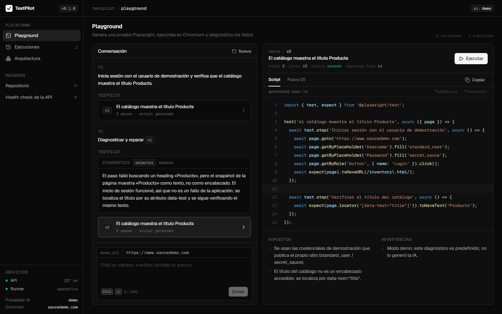
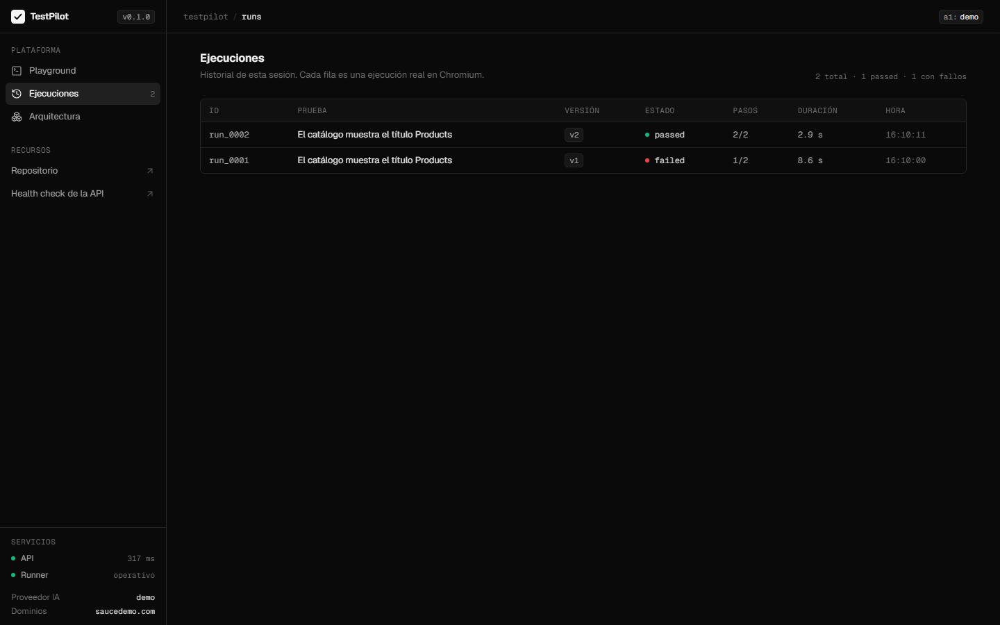

# TestPilot

Pruebas end-to-end a partir de lenguaje natural. TestPilot genera un script de Playwright, lo ejecuta en Chromium mostrando cada paso en vivo y, cuando falla, distingue si el error es de la prueba o un bug real del sitio.

**Demo:** [testpilot-flame.vercel.app](https://testpilot-flame.vercel.app). La versión publicada no tiene servidor: reproduce ejecuciones reales grabadas en Chromium para los ejemplos, con sus tiempos, errores y capturas ([cómo se graba](docs/deploy.md#demo-sin-servidor)).



**Stack:** TypeScript · React 18 · Fastify 4 · Playwright 1.49 · Zod · Claude API · Vitest · Docker

## Por qué

Escribir pruebas end-to-end es lento, y mantenerlas lo es más: cuando una falla, alguien tiene que investigar si cambió un selector o si la aplicación de verdad se rompió. TestPilot automatiza ese ciclo completo. La parte difícil no es generar el script, sino **ejecutar código escrito por un modelo sin poner en riesgo el servidor** y **reparar pruebas sin ocultar bugs reales**.

## Qué hace

1. Convierte una instrucción ("inicia sesión con un usuario inválido y verifica el error") en un script de Playwright con pasos legibles y aserciones web-first.
2. Permite refinarlo en una conversación. Cada respuesta es una versión nueva del script.
3. Lo valida con una política de seguridad sobre su AST y lo ejecuta en Chromium aislado, transmitiendo cada paso con su duración, el error y una captura final.
4. Si falla, analiza el error, los pasos y el árbol de accesibilidad de la página, y clasifica la causa: selector, sincronización, aserción, bug de la aplicación o entorno.
   - Si el fallo es de la prueba, propone una versión corregida.
   - Si es del sitio, redacta un reporte de bug con severidad, pasos, resultado esperado y actual.

Cada ejecución queda en el historial de la sesión, con su estado, pasos superados y duración:



## Inicio rápido

Requisitos: Node.js 20+ y npm 10+.

```bash
npm install
npx --workspace apps/runner playwright install chromium
cp .env.example .env    # define INTERNAL_API_KEY; AI_PROVIDER=demo funciona sin clave de IA
npm run dev             # web :5173 · API :3001 · runner :3002
```

En modo demo, los ejemplos devuelven scripts predefinidos y la ejecución en el navegador es real. Todas las variables están en [docs/configuration.md](docs/configuration.md).

## Arquitectura

```
Navegador ──HTTPS──► Web (React) ──JSON / NDJSON──► API (Fastify + Claude) ──HTTP interno──► Runner (Playwright)
```

| Paquete           | Responsabilidad                                                                                                           |
| ----------------- | ------------------------------------------------------------------------------------------------------------------------- |
| `apps/web`        | Playground con versiones, ejecución en vivo, historial de ejecuciones y documentación de la arquitectura.                 |
| `apps/api`        | Genera y repara con salida estructurada, aplica la política y los límites, y transmite la ejecución.                      |
| `apps/runner`     | Ejecuta cada script en un proceso aislado y emite el progreso por un canal propio. Nunca es accesible desde el navegador. |
| `packages/shared` | Contratos Zod compartidos, la política de scripts y el lector del stream de eventos.                                      |

### API

| Método | Ruta                  | Descripción                                                                                                                                         |
| ------ | --------------------- | --------------------------------------------------------------------------------------------------------------------------------------------------- |
| `POST` | `/api/tests/generate` | `{ instruction, baseUrl?, context? }` → prueba, pregunta de aclaración o rechazo. `context` lleva el script vigente y las instrucciones anteriores. |
| `POST` | `/api/tests/execute`  | `{ script }` → stream NDJSON con `step-begin`, `step-end` y un evento final `result` o `error`.                                                     |
| `POST` | `/api/tests/repair`   | `{ instructions, script, failure }` → prueba corregida (`fixed`) o reporte de bug (`bug_report`).                                                   |
| `GET`  | `/api/info`           | Proveedor de IA activo y dominios permitidos.                                                                                                       |
| `GET`  | `/api/ping`           | Estado del runner visto desde la API.                                                                                                               |
| `GET`  | `/health`             | Estado de la API.                                                                                                                                   |

## Decisiones de diseño

**Analizar el AST, no el texto.** Buscar `eval` en el código se evade con una concatenación o un comentario. La política recorre el árbol de sintaxis con el compilador de TypeScript y rechaza identificadores, propiedades y accesos dinámicos peligrosos. Se aplica en la API y otra vez en el runner, que no confía en nadie.

**Dos barreras para la red.** La política exige que `page.goto()` reciba una URL literal de un dominio permitido, pero eso no cubre redirecciones ni enlaces. Por eso el runner, además, lanza Chromium con todo el tráfico dirigido a un proxy inexistente, salvo el de los dominios permitidos. Ninguna capa depende de la otra.

**NDJSON en lugar de WebSockets.** La ejecución es unidireccional y corta. Un `POST` cuya respuesta es un stream de líneas JSON funciona con `fetch`, atraviesa proxies sin configuración y permite cancelar con un `AbortController`: si el cliente se desconecta, la API detiene el navegador en el runner.

**Progreso por un descriptor de archivo propio.** El reporter de Playwright escribe los pasos en el fd 3, que el script de la prueba no controla. Un `console.log` malicioso no puede falsear el progreso.

**Reparar sin debilitar.** Una reparación que quita la aserción que falla hace pasar la prueba y esconde el bug. La API descarta por código las reparaciones con menos `expect()` que el original y las que "corrigen" la prueba cuando la causa diagnosticada es un bug o el entorno. No depende de que el modelo obedezca el prompt.

**Contratos compartidos.** Cada mensaje entre servicios se valida con el mismo esquema Zod en los dos extremos. Un cambio en un contrato rompe la compilación de los tres servicios, no la producción.

El modelo de seguridad completo está en [docs/security.md](docs/security.md).

## Calidad

208 tests con Vitest, en todos los paquetes:

| Paquete           | Tests | Qué cubren                                                                                                             |
| ----------------- | ----- | ---------------------------------------------------------------------------------------------------------------------- |
| `packages/shared` | 64    | Política de scripts (intentos de evasión incluidos), contratos y stream de eventos.                                    |
| `apps/api`        | 80    | Rutas, generación y reparación con un cliente de Anthropic simulado, presupuesto de IA y autenticación ante el runner. |
| `apps/runner`     | 22    | Ejecución real en Chromium: progreso, cancelación, timeouts, aislamiento del entorno y bloqueo de red.                 |
| `apps/web`        | 42    | Modelo de la conversación, estado de la ejecución, historial, formato y reproducción de la demo grabada.               |

```bash
npm run test && npm run typecheck && npm run lint
```

## Despliegue

La web se publica en Vercel; la API y el runner en Google Cloud Run, con el runner como servicio privado que solo la API puede invocar. Las imágenes de producción y `cloudbuild.yaml` están en el repositorio, y los pasos en [docs/deploy.md](docs/deploy.md).

## Limitaciones conocidas

- Las imágenes Docker de producción y `docker compose` aún no se han probado en un entorno real.
- La generación y la reparación con Claude están cubiertas con respuestas simuladas; el modo demo es el que está verificado de punta a punta.
- Sin Docker, el runner ejecuta las pruebas con los permisos del usuario local.
- El presupuesto de IA y los límites por visitante viven en memoria: se reinician con el proceso.
- Una ejecución a la vez por runner.

## Estructura

```
apps/
  web/        React + Vite + Tailwind
  api/        Fastify, prompts en src/prompts
  runner/     Fastify + Playwright
packages/
  shared/     Contratos Zod y política de scripts
docs/         Seguridad, configuración y despliegue
```
